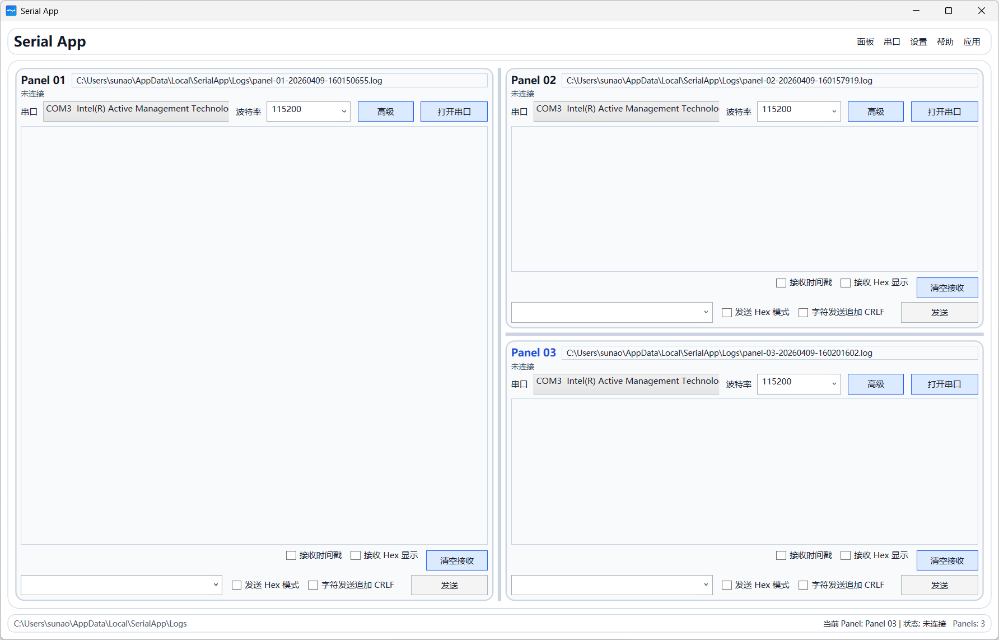

# SerialApp.Desktop

一个基于 WPF 的多 Panel 串口通信终端应用程序，支持灵活的分屏布局和多串口并发操作。



## 功能特性

- **多 Panel 布局**：支持水平和垂直分屏，可同时操作多个串口
- **实时串口通信**：支持文本和 Hex 模式收发数据
- **全局接收时间戳**：菜单栏上的常驻勾选框，一键开关接收时间戳，状态在所有面板间共享并持久化
- **滚动锁定**：接收区支持滚动锁定，双击切换，便于在高吞吐时固定查看某一段数据
- **独立日志记录**：每个 Panel 生成独立的 UTF-8 日志文件
- **设备热插拔检测**：自动检测串口设备的插入和移除
- **发送历史记录**：保存最近 32 条发送记录，多 Panel 共享
- **灵活的波特率配置**：支持自定义数据位、停止位、校验位，以及高级串口参数
- **字体设置**：可自定义面板字体，设置在所有面板间共享
- **窗口置顶**：菜单栏置顶按钮，便于将窗口固定在最前
- **一键清空接收**：菜单栏工具按钮，一键清空全部面板的接收窗口
- **内存诊断**：可手动记录内存快照，定位内存占用问题
- **Git Bash 面板**：可在布局中嵌入 Git Bash 窗口面板

## 技术栈

- **框架**：.NET 10.0 with WPF
- **语言**：C#
- **架构模式**：MVVM（递归布局树）
- **主要依赖**：
  - System.IO.Ports (10.0.5)
  - System.Management (10.0.0)

## 项目结构

```
SerialApp.Desktop/
├── App.xaml                 # 应用程序入口和全局异常处理
├── MainWindow.xaml          # 主窗口 UI 定义
├── ViewModels/
│   ├── MainWindowViewModel  # 主窗口视图模型
│   ├── SerialPanelViewModel # 串口 Panel 视图模型
│   ├── SplitPanelNodeViewModel # 分屏布局视图模型
│   ├── PanelViewModelBase   # 面板视图模型基类
│   ├── GitBashPanelViewModel # Git Bash 面板视图模型
│   ├── LayoutNodeViewModel  # 布局节点视图模型基类
│   └── ViewModelBase        # 视图模型基类
├── Models/
│   ├── SerialPortOption     # 串口配置选项
│   ├── SerialPortSettings   # 串口参数设置
│   ├── SerialAdvancedSettings # 高级串口参数
│   ├── AppPreferences       # 应用首选项
│   └── PanelFontSettings    # 面板字体设置
├── Services/
│   ├── SerialPortCatalogService  # 串口设备目录服务
│   ├── SerialPortSession         # 串口会话管理
│   ├── PanelLogWriter            # 日志写入服务
│   ├── AppStateService           # 应用状态与持久化管理
│   ├── MemoryDiagnosticsService  # 内存诊断快照服务
│   └── GitBashWindowHostService  # Git Bash 窗口托管服务
└── Docs/
    └── UserGuide.txt        # 用户使用说明
```

## 运行环境

- **操作系统**：Windows 10/11
- **.NET 版本**：.NET 10.0 SDK
- **硬件要求**：需要可用的串口（物理或虚拟）

## 构建和运行

```bash
# 还原依赖
dotnet restore

# 构建项目
dotnet build

# 运行应用
dotnet run
```

发布 Release 版本（输出打包到 `artifacts/`）：

```bash
./publish-release.sh                  # bash，默认：Release / win-x64 / 框架依赖
# 或
pwsh ./publish-release.ps1            # PowerShell 等价脚本
# 可用选项：-c Release -r win-x64 --self-contained --skip-zip --package-label <label> --no-restore
```

## 使用说明

### 基本操作

1. 启动应用后，默认显示一个串口 Panel
2. 选择串口号、波特率等参数
3. 点击"打开串口"建立连接
4. 在接收区查看数据，在发送区输入并发送数据
5. 发送区输入完成后可直接按回车发送

### 分屏操作

- **向右分屏**：菜单 → 面板 → 在右侧新增
- **向下分屏**：菜单 → 面板 → 在下方新增
- **关闭 Panel**：菜单 → 面板 → 关闭当前

### 菜单栏工具条

- **🧹 一键清空**：清空全部面板的接收窗口
- **📌 置顶**：切换窗口置顶
- **接收时间戳**：勾选框，开关全局接收时间戳（所有面板共享，状态持久化）

### 日志管理

- 默认日志目录：应用程序所在目录下的 `Logs/`
- 若默认目录不可写，自动回退到 `%TEMP%/SerialApp/Logs`
- 日志文件以 UTF-8 编码保存，便于记事本直接打开
- 双击日志路径可用记事本打开
- 可通过菜单 → 设置 → 选择日志目录 自定义，或恢复默认目录

## 配置文件

配置与日志文件均位于**应用程序所在目录**（即可执行文件同级目录，`AppDomain.CurrentDomain.BaseDirectory`）下，而非用户配置目录：

- **应用配置**：`settings.json`（日志目录、面板字体、接收时间戳开关、发送历史等）
- **启动日志**：`startup.log`（全局异常与启动诊断）

## 状态说明

| 状态 | 说明 |
|------|------|
| 未连接 | 尚未打开串口 |
| 已连接 | 已成功连接串口 |
| 打开失败 | 串口打开失败，请检查参数或占用 |
| 发送失败 | 发送时发生错误 |
| 串口错误 | 串口通信异常 |
| 未连接（COMx 已移除） | 串口设备已拔出 |
| 接收缓存拥塞 | 接收速度过快，出现丢包保护 |

## 许可证

本项目仅供学习和开发使用。
